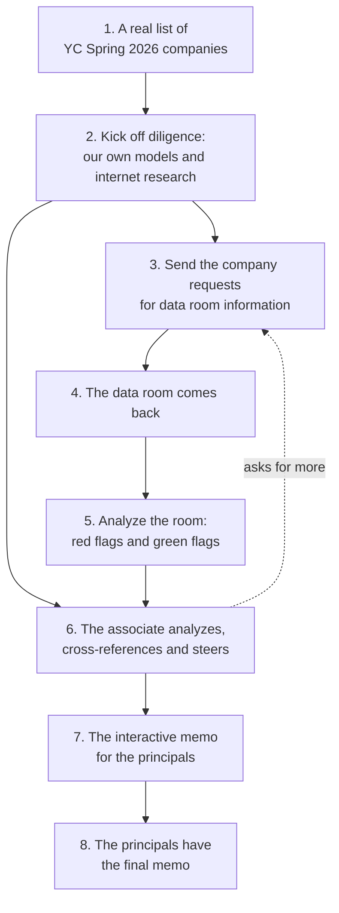

# Ken's Desk

**What this is:** Ken's working page for the hackathon. The top holds what needs Ken now. Comment on any item, and Claude answers on the page and updates the work. Hacking ends at **4:30 PM**, the demo freezes at **3:30 PM**, and judging runs 4:30 to 6:00.

**Last updated:** 2026-10-24 11:50, from the [board](BULLETIN.md), the commits since 10:00 and the [roadmap](ongoing/ROADMAP.md).

## Status at 11:50

**The demo you can show today is the data-room half: Hollis Voice and Brasswick, with red and green flags, steering and the memo. The half before the data room is not built yet.** By the [demo workflow](ongoing/diagrams/demo_workflow.md):

- **Steps 1 and 2, the YC list and our own research: not started.** Benjamin has the [brief](features/20261024.01_pre_room_diligence/00_brief.md) since 11:34. The list of 193 YC Spring 2026 companies and six companies' saved public data are ready for it.
- **Step 3, asking for the data room: half built.** Drafting the request to the founder works. Room-requests (the automatic check and the associate's editable list) is Benjamin's, not started.
- **Step 5, red and green flags: mostly built.** Deck against the books, accounting mislabels and contract terms are done. The red-flag engine still lacks several planted-flag checks. Pitch video not started.
- **Steps 6 to 8, steering and the memo: mostly built.** Steering, the readout store and the memo (page and PDF) are done. The readout page still lacks the claims and cohort panels and the memo link.

**The team, from the board:**

- **Benjamin** has moved the repo to a TypeScript workspace (pnpm and Turbo, `apps/web`, `apps/api`, `packages/schema`; 11:36 to 11:38). The Python API still runs the scans. His board post says his RPC and mobile work is not committed yet. Not started: the pre-room brief, room-requests, tasks for Tirth.
- **Kimmy** and **Tirth**: nothing on the board yet. Their agents set them up on first run; they need GitHub invites if they lack them.
- **Roles with no person:** the red-flag engine (design-and-finance), the readout (captain), pitch video and contract reading (backend-and-data).

**Counts** from [status_counts.py](ongoing/roadmap/status_counts.py): 13 slices done, 10 partly built, 29 not started, 5 waiting on you.

**To look at the demo flow now:** the [demo workflow](ongoing/diagrams/demo_workflow.md) and [DEMO.md](ongoing/DEMO.md). The app runs on this laptop at <http://localhost:5173/>, with readouts for Hollis Voice and Brasswick. No Anthropic key is on this laptop, so the model's readings show as gaps; the script checks all ran.

## The demo flow, from the beginning

Written 11:56. Each step of the [demo workflow](ongoing/diagrams/demo_workflow.md): what we have, what we need, and who.

### 1. A real list of YC Spring 2026 companies

- **We have:** the list, 193 companies saved from YC's public directory on 2026-10-22 ([CSV](reports/20261022.02_research/raw/demo_companies/yc_spring_2026_companies.csv)). Six were researched and ranked for the demo ([research_demo_companies.md](reports/20261022.02_research/research_demo_companies.md)): Ploy, Tasklet, Sazabi, TesterArmy, Minicor, Expanse.
- **We need:**
  - **Your pick of two or three.** The research recommends **Ploy** (every outside tab finds something real, and its SEC filing matches the press) and **Sazabi** (the cleanest and safest footprint). Tasklet has the deepest record, but it puts an invented room under a famous founder's company. *You.*
  - **A list screen in the app.** Today the app opens on a dropdown of our sample rooms ([localhost:5173](http://localhost:5173/)), not on companies. *Benjamin, [company-setup](ongoing/roadmap/company-setup.md).*

### 2. Kick off diligence: our own models and internet research

- **We have:** the six companies' public data, already saved: SEC Form D filings, GitHub, Hacker News and App Store lookups ([raw/demo_companies/](reports/20261022.02_research/raw/demo_companies/)). The full design of the outside-world scan ([outside-in](ongoing/roadmap/outside-in.md)). No code for it yet.
- **We need:**
  - **The outside-world scan on the free sources** (website, Hacker News, App Store, SEC), run from the saved copies so it works offline. *Benjamin.*
  - **Founder cards from GitHub.** *Benjamin.*
  - **An Anthropic key on the demo laptop.** This laptop has none, so every model reading shows as a gap. *You.*
  - Comps and market signals are nice to have; they need more keys.

### 3. Send requests for data room information

- **We have:** the drafted message to the founder, with guidance per document, on the readout page ([founder-requests](ongoing/roadmap/founder-requests.md), built). Checklist coverage works out what is missing for the stage.
- **We need:** the automatic check and the associate's list to check, uncheck and add to ([room-requests](ongoing/roadmap/room-requests.md)). For a company with no room yet, the first request is the stage's standard first-tier list. *Benjamin.*

### 4. The data room comes back

- **We have:** synthetic rooms for Hollis Voice (Series A) and Brasswick (seed), plus clean and variant copies, from the generator in `data_room/`. Adding a returned file to a room works (founder-requests).
- **We need:** **a synthetic room for each company you pick**, labelled synthetic on every page ([yc-rooms](ongoing/roadmap/yc-rooms.md)). *An agent, as soon as you pick.*

### 5. Analyze: red flags and green flags

- **We have:** deck against the books, accounting mislabels, contract terms, claim support and checklist coverage, all running on both rooms; the readout opens on the top green and red flags.
- **We need:** the red-flag engine's missing planted-flag checks; the pitch video's transcript (it needs your recorded video); the model's reading of contracts. *Nobody holds these yet.*

### 6. The associate analyzes, cross-references and steers

- **We have:** the readout page (top flags, overview, gaps, could not verify, ask list), steering, and the readout store.
- **We need:** the claims and cohort panels, and source links across claims ([readout](ongoing/roadmap/readout.md), [readout-page](ongoing/roadmap/readout-page.md)). *Nobody holds these yet.*

### 7 and 8. The interactive memo for the principals

- **We have:** the memo as a page and a PDF, built ([memo-export](ongoing/roadmap/memo-export.md)), at `/api/rooms/<room>/memo.html` and `.pdf`.
- **We need:** the PDF is dropped. The deliverable is interactive, and Benjamin is building the interactive principal's page ([UI decisions](features/20261024.02_first_steps_ui/02_ui_decisions.md#the-memo-for-the-principal)).

### What would unblock the most

1. **Your pick of companies** unblocks steps 1, 2 and 4.
2. **An Anthropic key on the demo laptop** turns the model's gaps into readings.
3. **Owners for steps 5 and 6.** Everything there is unassigned; Kimmy's expert knowledge feeds step 5.

## Notes

- Data room will need to send requests for more data
- customer testimonials are from b2b side
- b2c often want more info about traction (often social presence, not often strong enough)
- validating, are the founders saying the truth, but the vcs are less knowledgeable than the founders, so it's hard
- first thing is what's in the data room and what do we need to ask for, and automate this

### From the notes

- **What's in the room and what to ask for, automated:** on the roadmap as step 3, [room-requests](ongoing/roadmap/room-requests.md). It checks the room on arrival, lists what is missing, and the associate checks, unchecks and adds items before the request is drafted.
- **Requests for more data:** built. The [founder-requests](ongoing/roadmap/founder-requests.md) slice drafts the message to the company asking for what the room is missing, with guidance on what to send.
- **Testimonials (B2B) and traction from social presence (B2C):** nothing checks either yet. The nearest slice is [online-presence](ongoing/roadmap/online-presence.md), not started. Say if these should become checklist items or part of that slice.
- **Checking whether founders tell the truth when the VC knows less than they do:** this is the core of what is built. The [claim-support](ongoing/roadmap/claim-support.md) scan checks every figure in the deck and the pitch against the room's own files, and the red-flag checks compare numbers by script, so the VC does not need the founder's expertise to see where the founder's own documents disagree. It could be a line in the pitch.

## The demo workflow

The framework for what we build, from your 11:15 note. Each step with the slices behind it and their status: [demo_workflow.md](ongoing/diagrams/demo_workflow.md).

Where it stands: steps 7 and 8 are built (the memo). Step 3 is partly built: the drafted request exists, and [room-requests](ongoing/roadmap/room-requests.md) adds the automatic check and the associate's list. Step 5 is mostly built. Step 6 is partly built. Steps 1, 2 and 4 are not started. The roadmap's demo path now follows the workflow, starting with [company-setup](ongoing/roadmap/company-setup.md): pick a company from the saved YC Spring 2026 list and run our own research before any room.

## Needs your call

Each item says who is waiting and what Claude recommends.

- [ ] **1. Who is on the team, and what each person builds.** So far on the board: Benjamin (the TypeScript port) and Tirth (tasks coming from Benjamin). Kimi is with you now. The roadmap's Saturday roles are captain, frontend, backend-and-data and design-and-finance. **Claude recommends** writing each person's name and area in the Notes, and Claude puts them in the Team table in [AGENTS.md](../AGENTS.md) and on the roadmap. *Waiting: everyone's agents, which assign work by role.*
- [ ] **2. GitHub access.** The repo is private. Benjamin already pushes. Tirth and Kimi need an invite to `kenxle/tricorder` (Settings, Collaborators) before their agents can pull. *Waiting: Tirth, Kimi.*
- [ ] **3. What runs at the 3:30 PM freeze.** Benjamin is porting to TypeScript; the Python version is the one that works today. **Claude recommends** the freeze runs whichever version passes the answer-key check at 3:30, with Python as the fallback. *Waiting: Benjamin ([board](BULLETIN.md), 11:01).*
- [ ] **4. The social post at 11:00.** The first post for the $150 social content prize. Drafts: [social-posts](ongoing/roadmap/social-posts.md). The second post is at 3:30.
- [ ] **5. The real YC companies for the live beat.** **Claude recommends Ploy and Sazabi.** Candidates: [research_demo_companies.md](reports/20261022.02_research/research_demo_companies.md). An agent builds their synthetic rooms once you pick. *Waiting: the outside-in and yc-rooms slices.*
- [ ] **6. API keys in `.env` on the demo laptop.** Anthropic first; then the sponsor keys that arrive today (Akta, Crunchbase, Nicrron). [keys](ongoing/roadmap/keys.md). *Waiting: cached-data, comps, market signals, outside-in.*
- [ ] **7. Ask the organiser to change the track and pitch.** The Team Match Network lists Tricorder as "sourcing, diligence" with the old pitch; only the admin can edit it.
- [ ] **8. Record the pitch video.** Read the Hollis Voice script flatly: [pitch_video_script.md](../data_room/hollis_voice/01_overview/pitch_video_script.md). Save it as `pitch_video.mp4` beside the script. *Waiting: the pitch-video slice, which uses the script until then.*
- [ ] **9. The founder brief in your words.** The one page the judges get: [founder-brief](ongoing/roadmap/founder-brief.md).

## Lower priority

Nothing waits on these; the code follows Claude's defaults until you say otherwise.

- The wave 1 and wave 2 defaults (board tasks TRI-wave1-defaults and TRI-wave2-defaults), including whether a figure only the company's own model states counts as support.
- Which Startup Due Dil ideas to adopt: [proposals](ongoing/roadmap/proposals.md).
- The 18 decision cards on the [plan overview page](features/20261022.01_hackathon_plan/00_overview.md).

## Where things stand

From the [roadmap](ongoing/ROADMAP.md), "Up next". Status counts are from [status_counts.py](ongoing/roadmap/status_counts.py).

| Area | Owner | State |
|---|---|---|
| Red flags in the numbers ([redflag-engine](ongoing/roadmap/redflag-engine.md)) | design-and-finance | Partly built. Several planted-flag checks still missing. |
| The readout ([readout](ongoing/roadmap/readout.md)) | captain | Partly built. Source linking, the ask list and connecting sentences left. |
| The page judges see ([readout-page](ongoing/roadmap/readout-page.md)) | frontend | Partly built. Claims and cohort panels, memo link, video jump left. |
| Pitch video ([pitch-video](ongoing/roadmap/pitch-video.md)) | backend-and-data | Not started. |
| TypeScript port ([typescript-port](ongoing/roadmap/typescript-port.md)) | Benjamin | Not started. Decided at 11:00. |
| Demo freeze ([demo-freeze](ongoing/roadmap/demo-freeze.md)) | captain | Starts at 1:00 PM. |

## Done

Newest first.

- 11:28: Demo path follows the workflow; company-setup added as the first slice (pick a YC company, research before the room).
- 11:19: Kimmy's slice, expert-knowledge.
- 11:18: room-requests, for Benjamin.
- 11:17: The demo workflow diagram.
- 11:05: Board asks Benjamin to write tasks for Tirth.
- 11:01: TypeScript port set up for Benjamin: slice, roadmap section, team row, board message.
- 10:54: Roadmap reshaped: what to build next and who builds it; each slice in its own file.
- 10:10: AGENTS.md and the board work the way they did at the last hackathon.
