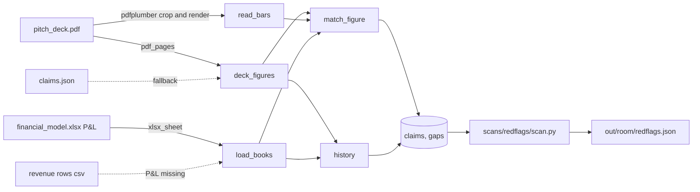

# Architecture: deck-vs-books

Requirements are in the [PRD](03_prd.md). Acceptance is in the [Plan](05_plan.md#verification). This page covers where the check sits, the data shapes, the flow and the choices behind them.

## Summary

One module, `scans/redflags/deck_vs_books.py`, inside the red-flag engine. It exposes `check(room: Path, ids: Ids) -> tuple[list[Claim], list[Gap]]`. The engine's `scans/redflags/scan.py` already lists `"deck_vs_books"` in `CHECKS`, so no edit there. It reads the deck and the model through `schema/readers.py`, takes tolerances from `schema.settings.load()`, and writes claims under two check names: `deck_revenue_vs_pnl` and `deck_history_vs_metrics`.

## The skeleton it plugs into

Read from `origin/claude/project-thread-ce34ga` at revision `573567f`, with `git show`. Nothing here is assumed; each name below is in that revision.

| What | Where | Used for |
|---|---|---|
| `Claim`, `Source`, `Value`, `Check`, `Gap` | `schema/claim.py` | The output. `Claim` refuses an empty `sources`. `Gap` has an optional `piece`. |
| `pdf_page(path, page)`, `pdf_pages(path)` | `schema/readers.py` | Slide text. The quote checker reads the same text. |
| `xlsx_sheet(path, sheet)`, `xlsx_cell(path, ref)` | `schema/readers.py` | The P&L tab, and each cell's value for a quote. |
| `csv_rows(path)` | `schema/readers.py` | The revenue rows (DVB-R9). |
| `LocatorError` | `schema/readers.py` | Raised on a bad locator. The check turns it into a gap, never a crash. |
| `load()` | `schema/settings.py` | `match_tolerance` (default 0.01) and `chart_shape_tolerance` (default 0.02, added by this feature). |
| `Ids` | `scans/base.py` | `ids()` gives each new claim id, `redflags-NNN`. |
| `find(room, kind)` | `scans/base.py` | `find(room, "deck")`, `find(room, "deck_claims")`, `find(room, "model")`, `find(room, "customers")`. |
| `gap(what, why, would_need, piece)` | `scans/base.py` | Every gap, with `piece="traction_and_revenue"`. |
| `check_result`, `check_claim` | `schema/check_quotes.py` | Acceptance: every claim verified (DVB-R12). |
| `score` | `eval/score.py` | Acceptance: BF2 found on Brasswick. "Found" means a `flag` claim whose `check.name` equals the key's and that cites a key file. |

Tests go in `scans/redflags/tests/test_deck_vs_books.py`. The repo runs them with `pytest` (`pyproject.toml`, `testpaths`).

## Reconnaissance of the rooms

What the spike found, by file. The run logs are in [spike/out/](spike/out/).

- **Hollis Voice deck** (`01_overview/pitch_deck.pdf`, 14 slides). Revenue figures: "$2.5M" ARR on slide 3, the claims-page row "ARR $2,500,000 3" on slide 14, a chart on slide 3 captioned "Monthly recurring revenue, January 2025 to September 2026.", and "Revenue grows 3.5% a month in the plan." on slide 11. Slide 1 says "Data as of 2026-09-30". The chart is one PNG with 21 single-colour bars and no values in the text.
- **Brasswick deck** (12 slides). "$943K" and "$84,810" on slide 4; claims rows "Revenue, last 12 months $943,340 4", "MRR, September 2026 $84,810 4" and "Monthly revenue chart 2026-01 to 2026-09 4" on slide 12; caption "Monthly revenue, January 2026 to September 2026"; "Revenue grew every month in 2026." on slide 4.
- **The P&L tab** of `02_financials/financial_model.xlsx`, in both rooms. Row 4 holds "Line", "Section" and one column per month. Row 5 marks each month "Actual" or "Plan". Revenue lines have "Revenue" in column B. Hollis Voice's lines: "Subscription revenue", "Pilot revenue", "Onboarding fees (one-time)", "Recurring revenue (subscription plus pilot)", "Total revenue". The clean room names the recurring line "Recurring revenue (subscription)", so the check matches the prefix "Recurring revenue". Brasswick's: "Subscription revenue", "Recovery revenue", "Total revenue".
- **Revenue rows.** `03_metrics/customer_mrr_by_month.csv` (Hollis Voice, column `mrr`) sums to the P&L's recurring line in all 21 months. Brasswick's `03_metrics/revenue_by_customer.csv` (`subscription_revenue` plus `recovered_from_carriers`) differs from "Total revenue" in 2026-09 by $25,245, which is BF4.

## Data shapes

Inside the module, before any Claim is made:

```python
@dataclass(frozen=True)
class Cell:
    value: float
    ref: str            # "P&L!W10", the locator a Source uses

@dataclass(frozen=True)
class Books:
    months: list[str]               # "2025-01", ... in column order
    kind: dict[str, str]            # month -> "Actual" | "Plan"
    lines: dict[str, dict[str, Cell]]   # line label -> month -> Cell
    recurring_label: str            # first label starting "Recurring revenue", else "Subscription revenue"
    first_revenue_month: str        # first actual month with "Total revenue" above zero
    source: str                     # "02_financials/financial_model.xlsx", or the revenue rows file (DVB-R9)

@dataclass(frozen=True)
class DeckFigure:
    kind: Literal["stated", "chart", "plan_growth", "grew_every_month"]
    slide: int
    quotes: list[tuple[int, str]]   # (slide, exact text) for every deck source
    label: str | None = None        # claims-page label, e.g. "ARR"
    number: float | None = None
    half_step: float = 0.0          # for a short-form figure only (DVB-R3)
    grain: Literal["monthly", "quarterly"] | None = None
    window: tuple[str, str] | None = None
    bars: list[int] | None = None   # pixel heights; None when unreadable
```

The output is the skeleton's `Claim` and `Gap`, field for field as in the interface example. Each claim sets `scan="redflags"`, `check=Check(kind="script", name=<one of the two>, model=None)`, `confidence="computed"`, and leaves `conflicts_with` and `corroborated_by` empty, because the memo fills them.

## Flow



1. `check` finds the deck with `find(room, "deck")`. None: one gap, return.
2. `deck_figures` reads every slide with `pdf_pages`, finds the figures (DVB-R1), and for each chart crops the slide's first image box and renders it with pdfplumber at 150 dpi for `read_bars` (DVB-R13).
3. `load_books` reads the P&L with `xlsx_sheet` and builds `Books`. No model: a gap, then the revenue rows if present (DVB-R9), else every figure is unmatched.
4. `match_figure` maps each figure by the PRD's table (DVB-R2) and returns one claim (DVB-R3 to R6).
5. `history` returns one claim per chart (DVB-R7), plus any gap for months the books lack (DVB-R10).
6. Source uris are made relative to the room before the claims leave the module (DVB-R12).

## Choices and alternatives

| Choice | Picked | Alternatives and why not |
|---|---|---|
| Where the code lives | `scans/redflags/deck_vs_books.py`, one `check` | A scan of its own. Rejected: the roadmap says it joins the red-flag engine, and the skeleton already lists it in `CHECKS`. |
| Reading the chart's bars | Pixels: bar count and each bar's share of the tallest, against the books' shares | OCR of the axis to get dollars: needs a new dependency. A model's vision read: needs a key and gives `judged`, not `computed`. Kept as a fallback for real decks (DVB-R8). |
| Getting the chart image | pdfplumber `page.crop(image box).to_image(resolution=150)` | pypdf's raw image: what the spike used, but pypdf is not in `requirements.txt`. The crop render gives the same bar counts on all four test charts ([spike/out/crop_render_check.txt](spike/out/crop_render_check.txt)). |
| ARR's books figure | 12 times the P&L's recurring line for the as-of month | `ARR_TOTAL`: already the engine's PF2 check. The subscription line only: that is entry 1.2's rebuild. |
| The books | The P&L tab | The metrics export `monthly_metrics.csv`: a company export, not the books. BF2's key cites it, but the scorer only needs the deck file, which the claim cites. |
| Partial-history check name | `deck_history_vs_metrics` | A new name: `eval.score` would then miss BF2. |
| The match table | A `Panel`, "deck against the books", returned as `check()`'s third element | Only in claim texts: what the first draft chose, because the first contract returned only claims and gaps. The framework now merges a third element into `ScanResult.panels`. |

## Failure modes

| Failure | Handling |
|---|---|
| A reader raises `LocatorError` or the file will not open | Caught. The input counts as missing and gets its gap. The check never crashes the engine. |
| The P&L tab is renamed or its header row moves | `load_books` looks for the row whose column A is "Line" in the first 15 rows. Not found: the "monthly P&L" gap. |
| A plan cell holds no cached value | The plan-growth figure is unmatched (the spike handles this). |
| The chart has two colours or a legend | `read_bars` takes the most common saturated colour. A stacked chart may read wrong; then the shape check flags it, which is a false flag. Real decks need the vision fallback. |
| The deck states a figure twice with different values | Each becomes its own claim. The check does not pick one (FRAMEWORKS 1.1). |

## Security and privacy

It reads only files inside the room folder. It writes nothing; the engine writes `out/<room>/redflags.json`. No network, no secrets, no personal data.

## Points settled with the skeleton owner

1. **Panels.** `check()` may return `(claims, gaps, panels)`, and `scans/redflags/scan.py` merges the panels. This module returns one.
2. **No image reader in `schema/readers.py`.** The module renders the chart itself with pdfplumber. Still open: the readers owner may move it into a `pdf_page_images(path, page)` reader.
3. **The setting.** `chart_shape_tolerance: 0.02` is in `schema/settings.py` `DEFAULTS`, with a comment naming the spike as its source.
4. **Test-deck sources.** The test fixture builds each test room in pytest's `tmp_path`, so every uri stays relative and the quote checker reads it.
5. **The bar reader scans the bottom-most bar row.** A bar under 1 percent of the tallest may be one or two pixels high. Scanning one row higher, as the spike did, missed it and reported a skipped month that was not there.
