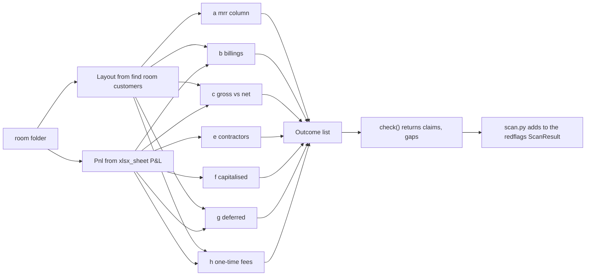

# Architecture: accounting mislabels

Requirements: [03_prd.md](03_prd.md). Verification: [05_plan.md](05_plan.md), "Verification". Output agreed in [02_interface_example.md](02_interface_example.md).

## Summary

One module, `scans/redflags/mislabels.py`, inside the red-flag engine. It exposes `check(room: Path, ids: Ids) -> tuple[list[Claim], list[Gap]]`. It runs seven sub-checks, each a pure function over a parsed view of the room, and returns their claims and gaps in entry 1.12's order. Scripts only: no network, no model.

## Existing structure

Read from the skeleton branch `origin/claude/project-thread-ce34ga` at commit 573567f, with `git show` (not checked out). These are confirmed names, not assumptions.

| Name | Where | Used for |
|---|---|---|
| `Claim`, `Source`, `Value`, `Check`, `Gap` (Pydantic v2, `extra="forbid"`) | `schema/claim.py` | Every output. `Claim` refuses an empty `sources`. `Gap` has an optional `piece`. |
| `Ids` | `scans/base.py` | `ids()` gives the next id, `redflags-001` and on, shared across every check in the engine run. |
| `gap(what, why, would_need, piece)` | `scans/base.py` | Builds a Gap and adds "Not in the room:" when missing. |
| `find(room, kind)`, `room_inputs(room)` | `scans/base.py` | Which files supply `customers`, `ledger`, `model`, `metrics`. `customers` matches both `customer_mrr_by_month.csv` and `revenue_by_customer.csv`. |
| `load()["match_tolerance"]` | `schema/settings.py` | 0.01 by default; `TRICORDER_SETTINGS` can override. |
| `csv_rows`, `csv_row_text`, `xlsx_sheet`, `xlsx_cell`, `xlsx_defined_name`, `LocatorError` | `schema/readers.py` | All file reads. `csv_rows` gives dicts whose first item is file row 2. |
| `check_claim` | `schema/check_quotes.py` | The quote checker. Ignores spacing and case; accepts `2240868`, `2,240,868` and `2240868.0` for one cell. |
| `CHECKS` already lists `"mislabels"` | `scans/redflags/scan.py` | No edit needed. A missing module is skipped. |
| `score(readout, key, room)` | `eval/score.py` | A planted entry is found when a flag claim has the key's check name and cites a key file. A decoy is flagged when a flag claim cites the decoy's file and one of its cell, named-cell or page locators. |

The spike validated its output against these models and ran `check_claim` and `score` from copies of these files ([spike/mislabels_spike.py](spike/mislabels_spike.py), [spike/score_spike.py](spike/score_spike.py)).

## Reconnaissance: the inputs as they are

| File | Room | What the module reads |
|---|---|---|
| `03_metrics/customer_mrr_by_month.csv` | Hollis Voice full rooms | `month`, `customer_id`, `customer_name`, `locations`, `plan`, `product_type` (Subscription, Onboarding, Pilot), `mrr`, `one_time_fee`, `billings` |
| `03_metrics/revenue_by_customer.csv` | Brasswick | `subscription_revenue` (stands in for `mrr`), `billings`, `recovered_from_carriers`, `recovery_fee`, `remitted_to_customer`. No product type, no one-time fee. |
| `03_metrics/monthly_metrics.csv` | all | Hollis Voice: `mrr`, `arr`. Brasswick: `total_revenue`, `subscription_revenue`, `recovery_revenue`; no `mrr`. |
| `02_financials/expense_ledger.csv` | full rooms, Brasswick | `month`, `vendor`, `description`, `category`, `booked_as`, `amount_usd` |
| `02_financials/financial_model.xlsx`, tab `P&L` | all | Row with "Line" in column A is the header; the next row says Actual or Plan per month; column B is the section. Rows: "Subscription revenue", "Total revenue", "Total cost of revenue", "Total operating expenses", "Onboarding fees (one-time)" (Hollis Voice), "Recovery revenue" and "Professional services" (Brasswick). |
| same, tab `ARR_Build` | Hollis Voice | Line table (Line, Product type, Customers, MRR, ARR counted) and a monthly history (Month, blank, Subscription MRR, Pilot MRR, ARR). Pilot is row 13; Onboarding row 14; "Subscription ARR" row 12. |
| same, defined names | all | `ARR_TOTAL`, `STAFF_NOW` or `EMPLOYEES_NOW`, `CASH_START`, `CASH_BRIDGE_DIFF`, `DEFERRED_REVENUE_USD` (Brasswick only) |

The seed drop's model and metrics file are byte-identical to the full room's (checked with `md5sum` during reconnaissance), so the seed-drop fallback reads the same cells.

## Data shapes

Named before the logic. All internal; only `Claim` and `Gap` leave the module.

```python
@dataclass(frozen=True)
class Layout:                 # which room shape; picked from the customers file's name
    customers: str | None     # "03_metrics/customer_mrr_by_month.csv" or ".../revenue_by_customer.csv"
    revenue_col: str          # "mrr" or "subscription_revenue"
    billings_col: str         # "billings"
    fee_col: str | None       # "one_time_fee" or None
    type_col: str | None      # "product_type" or None (every row is subscription)

@dataclass(frozen=True)
class Row:                    # one customer-file row
    file_row: int             # 2 for the first data row; the Source locator is f"row {file_row}"
    month: str
    values: dict[str, str]

@dataclass(frozen=True)
class Pnl:                    # the P&L tab
    months: list[tuple[str, str, str]]       # (month, "Actual" or "Plan", column letter)
    rows: dict[str, tuple[int, str | None]]  # label -> (sheet row, section)
    def cell(self, label: str, month: str) -> tuple[str, float] | None: ...  # ("P&L!W7", value)

@dataclass
class Outcome:                # one sub-check's result
    name: str                 # the check name
    label: Literal["flag", "watch", "clear", "cannot_check", "not_run"]
    claims: list[Claim]
    gaps: list[Gap]
```

Deck-vs-books parses the same P&L tab into its own `Books` shape ([its architecture](../20261022.11_deck_vs_books/04_architecture.md)). Two private parsers are fine for Saturday. If both land, a shared `scans/redflags/pnl.py` is the follow-up; see [05_plan.md](05_plan.md), "Throughput checkpoint".

## Flow



1. `check` builds `Layout` and, when the model exists, `Pnl`. A missing model leaves `Pnl` as None; sub-checks that need it return a gap.
2. Each sub-check runs in its own `try`. A `LocatorError`, `KeyError` or `ValueError` becomes a gap for that sub-check with `why` naming the column or row (AM-R6).
3. `check` concatenates claims and gaps in the order a, b, c, e, f, g, h.

## Decisions

- **D1. One module, one function per sub-check.** Each function takes `(room, layout, pnl, tol, ids)` and returns an `Outcome`. Tests call each function directly; `check` only composes.
- **D2. A column map, not a second module, for Brasswick.** `Layout` is picked from the customers file name that `find(room, "customers")` returns. Kind a needs an `mrr` column and a product type, so it is not_run on Brasswick; kind h needs a fee, so it is not_run too.
- **D3. The link to the pilot-as-ARR flag is a shared source.** The kind a claim cites the pilot's `ARR_Build` row (`ARR_Build!A13` and `E13`) and its customer-file row. Entry 1.2's flag cites `ARR_Build!E13` (PF1's location in `data_room/answer_key.json`). The readout groups claims that share a `uri` and `locator` as one cause. The same rule groups Brasswick's kind b and kind g claims, which both cite `P&L!S7`. Assumption to confirm with the redflag-engine builder: entry 1.2's claim cites `ARR_Build!E13`.
- **D4. A clear sub-check writes one info claim.** It states the tie-out and cites the cells it compared. It never cites a decoy row.
- **D5. Kind e and kind g extend entry 1.12.** Kind e adds the plan test and vendor propagation, because Brasswick's BF3 contractors are inside the actual P&L and only drop out of the plan. Kind g adds the cash-bridge deferred test, written as info when a P&L flag already fired, because `Cash_Bridge!B10` is a Brasswick DC1 location and `eval.score` counts any flag citing it.
- **D6. Tolerance comes from settings.** `schema.settings.load()["match_tolerance"]`, read once in `check`.

## Alternatives

| Choice | Picked | Not picked, and why |
|---|---|---|
| Link to the 1.2 flag | Shared source (D3) | A new Claim field: the schema is frozen. `conflicts_with`: it means a different number for the same label, and the two numbers here are MRR and ARR. A Panel: `check` returns no panels. |
| Show a clear | Info claim (D4) | Gap only: a clear is not missing input. Nothing: the readout then cannot show the check ran. |
| Entry 1.12's checks and lines tables | Not emitted on Saturday | A Panel needs `check` to return panels, or `scan.py` to build them. Ask the engine owner after Saturday. |
| Kind c test room | Written by a pytest fixture into `tmp_path` | A generator option in `generate.py`: changes a shared file and needs a byte-stable main room. Designed below in case the coordinator wants it. |
| Room shapes | Column map (D2) | A Brasswick module: duplicates every formula. |
| Contractor detection | Keywords plus vendor propagation | Model classification: entry 1.12's model reading. Not needed for any planted flag; scripts only on Saturday. |

## The generator option, designed

The slice asks for a generator option that writes a resale line into a test room. If the coordinator wants it in `data_room/generate.py` (open question Q2 in the PRD), this is the design. The spike's [write_test_rooms](spike/mislabels_spike.py) does the CSV half.

- Flag: `--resale-line`. Off by default, so the main room's bytes do not change. With it on, the run is a variant: it writes `hollis_voice_resale/`, its seed drop and `answer_key_resale.json`.
- In `build_tables`: for each paying subscription clinic from 2026-04, add a row with `product_type` "Resale", `plan` as the clinic's, `mrr` = $25 × locations, `billings` the same. Add the same amount to `F["rec"][m]`, so `monthly_metrics.mrr` carries it (the planted mislabel).
- In the ledger: one line a month, vendor a new wholesale carrier, `category` "resale_pass_through", `booked_as` "Cost of revenue", amount equal to that month's resale total.
- In `build_model`: a P&L Revenue row "Carrier minutes resold" and a Cost of revenue row "Carrier minutes bought for resale", so the ledger still ties and kinds e and f stay clear. Cached values are written by xlsxwriter as the rest of the model is.
- In the answer key: a flag `PF8` with `check` "gross_vs_net_revenue", `mislabel_kind` "c", its locations (the P&L row, a Resale row, a ledger line) and `catchable_from_seed_drop` false.
- `check.py` gains the matching read-back.

The spike's test room skips the ledger and P&L rows, because editing the cached values in the workbook with openpyxl would drop them. That is why it adds the money to the `mrr` column only.

## Failure modes

| Failure | Behaviour |
|---|---|
| P&L header moves | `Pnl` looks for "Line" in column A in the first 15 rows; not found means a gap "Not in the room: a monthly P&L" for sub-checks that need it. |
| Clean room renames the recurring row | Lines matching use the prefix "Recurring revenue". |
| A sub-check raises | Caught per sub-check; a gap with the reason; the rest still run. |
| One cause fires two sub-checks | Both cite one locator (D3). |
| A tolerance override from `TRICORDER_SETTINGS` | Read once; every formula uses the same value. |

## Security and privacy

The module reads local files in the room and writes nothing. It runs no code from the room and makes no network call. Room text reaches the readout only as quotes inside Claims, which the page renders as text. The rooms are synthetic ([data_room/README.md](../../../data_room/README.md)).

## Assumptions still to confirm

- Entry 1.2's flag cites `ARR_Build!E13` (D3). Owner: redflag-engine.
- The readout groups claims by shared source. Owner: readout slice. If not, the kind a text still names the pilot line, so the associate sees the same cause in words.
- `Ids` is shared across modules in one engine run, so mislabels ids follow whatever the earlier checks used. Tests match on `check.name`, never on an id.
