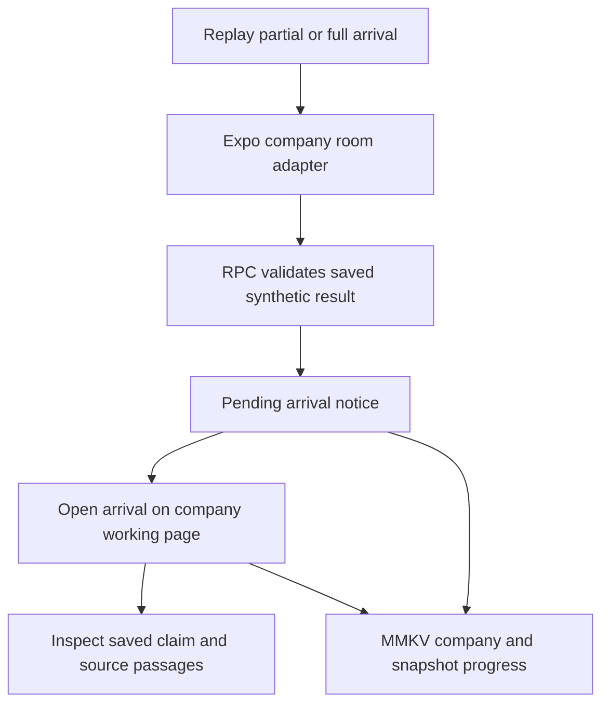

# Architecture

## Charter

**What belongs:** The shape of the system at a level a person can hold in their head. The stack and the folder structure. The surfaces people and agents touch, and the outside services behind them. The main models and how they relate, in outline.

**What does not:** How one feature works. That goes in a diagram or its own ongoing doc. How a feature got built. That stays in docs/features/.

**Level of detail:** A paragraph or a short table per area. Link out when a section passes three paragraphs.

**Describes:** the code root named in Settings

**Sources:** [PRODUCT_BRIEF.md](PRODUCT_BRIEF.md), [FEATURES.md](FEATURES.md) and [ROADMAP.md](ROADMAP.md) (every slice, both horizons), [FRAMEWORKS.md](FRAMEWORKS.md) ("How every entry works" and "The readout"), the feasibility research ([research_feasibility.md](../reports/20261022.02_research/research_feasibility.md), Part 4.1 for the stack and Part 2 for the outside sources), the [guardrails](../../.claude/guardrails.md), the earlier draft of this doc (git, commit 2c75f59), and the code on `main`. Where this doc and the code differ, the code is right and this doc is out of date.

## The shape in one paragraph

Tricorder is a set of Python scans that each read a company's files and write one JSON file of claims, a merge that turns those files into one readout, a small server that hands the readout to a web page, and the page. Every number a scan writes is a script's. A model only reads words, and every claim it writes carries the exact quote it relied on, which a script then finds again in the source. The readout is built only from claims, so every line on the page is two clicks from its source. The diagram is [diagrams/system.md](diagrams/system.md).

## The stack

**Moving to TypeScript.** Ken decided on 2026-10-24 at 11:00 AM to port Tricorder to TypeScript, with a React web app and a React Native app on one shared core. Benjamin builds it: [typescript-port](roadmap/typescript-port.md). Until the port scores the same on every answer key, the Python stack below is what runs.

| Layer | What | Why |
|---|---|---|
| Scans, merge, scoring | Python 3.11+, Pydantic, pandas, openpyxl, pdfplumber, the Anthropic SDK | The scans are Python-shaped (spreadsheets, PDFs, whisper, the model). The feasibility research recommends it (Part 4.1). |
| Server | FastAPI on uvicorn, `server/app.py`, localhost only. `server/local_guard.py` refuses a non-loopback Host, a cross-origin write and a text or form body on a JSON route. Each feature's routes live in `server/<feature>_routes.py`, included above the page mount. | The page reads JSON and never waits on Python. |
| Page | React 19, TypeScript, Vite, in `apps/web/` | The frontend works in parallel against generated types and sample files. No CDN, so the demo needs no wifi. |
| Store | Files: `out/<room>/` for results, `rooms/` for rooms that arrive by upload or the inbox, and `store_data/` for readouts saved per fund (`store/`, `python -m store`) | One laptop on Saturday. The store keeps each saved readout with its sources and files, lists what a fund holds for a company, and deletes it all with one confirmed command. |

Rejected: one Streamlit app (no room for the frontend role, and a prior financial-AI hackathon disqualified "Simple Streamlit only applications"), and Rails with Python subprocesses (two runtimes on the demo laptop, one bottleneck).

The web package also pins `@tanstack/intent` as development tooling for discovering agent skills in installed npm dependencies. The installed tRPC `intent` executable shadows that CLI and fails on the unavailable `intent-library` export. Direct invocation of Intent's installed CLI successfully discovers and loads the tRPC skills; no managed agent guidance has been generated. Commands live in [TESTING.md](TESTING.md#intent-agent-guidance).

## TypeScript workspace

The mobile Company entry uses `company/company-carousel.tsx` for the two saved companies, Ploy and Sazabi, without a URL form. The existing `company` route parameter still opens each readout, and “← Companies” returns to the cards. The carousel adapts Reacticx's MIT-licensed vertical snapping, scale and opacity behavior to the existing Reanimated runtime, measures content for larger text, and respects reduced motion. `card-gradient.ios.tsx` uses Expo UI's SwiftUI gradient fill; the platform fallback uses the installed Expo Image renderer for the same static gradient. Shadows sit outside the clipped rounded card. No dependencies or native configuration changed.

The root `package.json` pins pnpm 11.9.0. `pnpm-workspace.yaml` defines workspaces at `apps/*` and `packages/*`. `turbo.json` orchestrates package-owned build and typecheck scripts. Install from the root with `pnpm install --frozen-lockfile`; `pnpm-lock.yaml` pins every JavaScript dependency. Root dependencies are repo tooling only. Shared dependencies use `workspace:*` so they always resolve locally. pnpm uses its default isolated install layout; only esbuild is permitted to run a dependency build script. Python source stays in its current folders while the port proceeds. `apps/api/` is a dev-only workspace wrapper around that backend, not a TypeScript API port.

Root `pnpm dev` runs `@tricorder/api#dev`, `@tricorder/rpc#dev`, `@tricorder/web#dev` and `@tricorder/mobile#dev`. Use `pnpm dev:mobile` for Metro alone. Root `pnpm dev:mobile:device` instead runs the phone launcher with API and gateway through the persistent `dev:device` task and its `with` tasks. It starts one Metro with MCP and the phone-only proxy, omits Vite, and stops the whole task tree on Ctrl+C. Do not run it alongside another dev stack; package-local `pnpm dev:device` remains available for separately managed backends. Root `pnpm start` still launches only the API and gateway. The API launcher selects the project virtualenv, loads the root `.env` through Uvicorn without overriding exported values, and watches the Python source folders for reloads. `TRICORDER_PYTHON` explicitly overrides interpreter selection. The API task alone passes through backend environment variables; they are not globally forwarded to web tasks. `bin/serve --dev` delegates to the same Turbo command. Ctrl+C stops the task tree. `apps/web/turbo.json` starts API and gateway alongside the web task using `with`, so `pnpm dev:web` runs the complete web stack. Vite opens the page in the browser automatically.

`apps/rpc/` is a read-only tRPC 11 gateway on loopback port 8789. Explicit procedures for rooms, scan results, memos, store data, steering reads and founder requests delegate to Python REST, with Zod input schemas, bounded request timeouts and HTTP error mapping. Schemas strip unknown object keys, enforce safe path IDs and integer bounds without coercion, and normalize null or omitted versions to the latest version. Zod 3.25.76 is a direct gateway dependency, matching the version already in the workspace. `apps/web/src/trpc.ts` imports `AppRouter` as a type and uses the vanilla batched client; input types are inferred from Zod schemas without importing their runtime into the browser. Python proxies `/trpc` before its static page mount; Vite uses that same entry point. The browser uses tRPC for room lists and readouts, and REST for builds, sources, steering and founder requests. `bin/serve` runs Python and the gateway via Turbo start tasks. Node 22.13+ executes the gateway TypeScript with native type stripping. FastAPI validates declared response models. Steering GETs retain the existing lazy build and save when only scan results exist. The gateway derives return types from generated Python API contracts and trusts Python validation; this is a transport boundary, not a scan port.

`apps/web/` depends on `@tricorder/schema` through its package manifest. `schema/claim.py` remains the source of truth, and `python -m schema.export` writes `packages/schema/src/claim.ts` plus `schema/claim.schema.json`. The schema package exports TypeScript source directly, so app bundlers consume it without a separate compile step. It has no React, browser or Node dependencies. The schema freshness gate remains in `bin/ci-py`. `server/export_api.py` separately introspects FastAPI OpenAPI without running a server and writes `packages/schema/src/api.ts`, exported as `@tricorder/schema/api`. `PythonModels` preserves model references and `PythonAPI` maps HTTP operations to path/query/body/output types, including input/output optionality. `server/api_models.py` supplies response models for dictionary-shaped read endpoints. `pnpm generate:api` regenerates contracts after Python changes; `pnpm check:api` and `bin/ci-py` reject stale files. Only declared JSON contracts are exported; opaque dictionaries remain unknown, and downloads and the tRPC proxy are excluded. Explicit tRPC procedures select the generated operation, so clients infer types through `AppRouter` without duplicating Python fields. Generation does not run automatically during dev.

`apps/mobile/` is the official Expo SDK 58 default starter with Expo Router, React Native 0.88 and TypeScript. It declares `@tricorder/schema` through `workspace:*` and owns its Expo scripts and environment files. Metro discovers the pnpm workspace automatically. Package-owned `dev`, `typecheck`, `lint` and `build` tasks join Turbo; build exports Android, iOS and web bundles to `apps/mobile/dist/`, not native binaries. Its Rooms tab renders the readout in React Native through `src/readout/`: room selection/building, flags, steerable overview and claims, source inspection, evidence rows, revision diffs, gaps, asks and founder-request drafts/reply intake. Long lists use FlatList. The web implementation is preserved. `src/app/api/[...path]+api.ts` forwards an explicit set of readout REST routes to the local Python API, with generated `PythonAPI` contracts and no backend imports in the client. Expo launch commands bind to localhost; the adapter checks loopback Host, browser origin and JSON writes. Native uses the local Expo server, Android through adb reverse, and physical devices use `pnpm dev:mobile:device` for an explicitly scoped phone-only forwarder. The launcher detects iPhone Personal Hotspot or accepts explicit same-subnet Mac/phone IPv4 addresses, binds only that interface, checks the connecting peer and Host, rejects browser-origin traffic, and forwards HTTP/WebSockets to localhost Metro. Its temporary Expo proxy/API URL environment overrides advertise the reachable address; child Metro and proxy stop together. The peer IP is a development access boundary, not production authentication. This is a local adapter with no remote authentication; do not serve it over LAN, a tunnel or a public listener. `TRICORDER_API_URL` in the app environment overrides the loopback Python target; `EXPO_PUBLIC_API_URL` overrides the native Expo server URL and is required for release bundles. `expo-dev-client` supplies the custom native development app; `pnpm build:ios` compiles and installs it locally with Xcode, and mobile dev tasks start Metro in development-client mode. Native output stays in the ignored `apps/mobile/ios/` directory. SDK-compatible native dependencies are installed for clipboard actions (`expo-clipboard`), document intake (`expo-document-picker`, `expo-file-system`), memo sharing (`expo-sharing`), founder email drafts (`expo-mail-composer`) and pitch playback (`expo-video`); clipboard, document intake and email drafting are used by the readout; memo sharing and pitch playback remain future work. Keyboard Controller is installed and its provider wraps the root navigator; existing form avoidance is unchanged. Expo Haptics and NetInfo are installed for future interaction feedback and connectivity handling, with no active listeners or retry policy yet. These additions autolink and require a rebuilt development client. Sharing, mail composer and video register their config plugins in `apps/mobile/app.json`; incoming share extensions and background video playback are not enabled. The web and mobile apps use their own framework-compatible React versions in isolated installs; shared schema types contain no React code. The official Expo plugins provide agent skills. Plugin settings and MCP registration are configured separately on each developer machine. Each developer authenticates outside the repository. Runtime scan and reader ports should become separate packages as they are implemented; native and web clients should not import filesystem readers or server credentials.

Mobile local preferences use `react-native-mmkv` with `react-native-nitro-modules`. `apps/mobile/src/lib/storage.ts` exports one synchronous, unencrypted `tricorder.preferences` instance for non-sensitive values. The Company request dialog has a separate `tricorder.demo-requests` instance for explicitly saved demo drafts and stage; saved messages are captured verbatim and restored without regeneration. MMKV uses browser localStorage on web. Native development clients must be rebuilt after installing these dependencies; no additional app configuration is required.

`@expo/ui` is installed in the SDK 58 mobile package. Shared mobile actions, native fields and checklist controls use its universal components. `readout/native-sheet` uses a native sheet with existing RN virtualized lists inside. Its hosted RN root uses `flexGrow: 1` with `height: 0`, matching Expo UI’s sheet bridge so long content cannot expand the scroll viewport; Android uses Compose directly to lock swipe dismissal while busy, and web uses Expo UI's compatibility sheet for the same dismissal guard. Platform-specific modifiers retain field accessibility names. Web fields use labeled RN inputs because the universal web input does not forward accessible labels. Selectable readout prose remains React Native text. Its `expo-mcp` development dependency provides local Expo MCP tools. The mobile `dev`, `dev:device`, `ios`, `android` and `web` scripts set `EXPO_UNSTABLE_MCP_SERVER=1` automatically, including root/Turbo launches; direct Expo CLI launches still need the flag explicitly. The Expo CLI account must match the account authorizing the remote MCP connection. Remote server registration and OAuth credentials remain developer-local; reconnect the agent after starting or stopping Metro to refresh local capabilities.

Mobile company details use the root Expo Router modal `company-sheet` with its own native stack: details push evidence, Back returns to the same editable form, and Done dismisses the flow. Tabs live in `(tabs)` without changing their public URLs. `CompanyStateProvider` owns per-company in-session edits and stage above both navigators; explicit request saves keep their existing MMKV boundary. Evidence always resolves the saved source record rather than presenting an edited field as sourced fact. The report uses inline numbered evidence links instead of repeated source-title pills.

Turbo caches `dist/**` for builds and task logs for typechecks. Typechecks use a transit dependency so schema source changes invalidate consuming apps. Build inputs include each package's `.env` files; Turbo does not load them. The Python root `.env` remains backend configuration and is not forwarded to web tasks. Dev servers are persistent and uncached. Remote caching is not configured.

## Folder layout

Each folder has one owner, so parallel pull requests do not touch the same files. Owners match the roadmap's "Who owns what"; the roadmap wins if they differ.

| Folder | What it holds | Owner on Saturday |
|---|---|---|
| `schema/` | `claim.py` (the models), `claim.schema.json` (generated), `readers.py` (open a file at a locator), `check_quotes.py`, `settings.py` (the thresholds) | captain; `readers.py` backend-and-data |
| `scans/base.py` | The scan command line, result paths, ids, gaps, the input kinds a room holds | captain |
| `scans/redflags/` | Scan 1: one module per FRAMEWORKS entry 1.1 to 1.14 (1.14 is deck against the books). `contract_reader.py` is the one contract reader for entry 1.13. Each module numbers its own claims (`redflags-<module>-001`), and a module that crashes becomes a gap. | design-and-finance |
| `scans/comps/` | Scan 2: public comps and private rounds | design-and-finance |
| `scans/signals/` | Scan 3: market signals, from `cache/` | frontend on Saturday |
| `scans/video/` | Scan 4: transcript claims with timestamps, interesting moments | backend-and-data |
| `scans/claims/` | The claims workflow: every figure in the deck and the pitch script, labelled supported, contradicted or unsupported against the room | agent |
| `scans/readings/`, `scans/model/` | Model readings (pilot clause, cohort note); the model rebuild, unit economics and scenario numbers | backend-and-data; agent |
| `scans/frameworks/`, `scans/founders/`, `scans/presence/`, `scans/outside/` | Scans 5, 6 and 7, and the associate's ten tabs | agent |
| `scans/bank/` | The bank check | agent |
| `scans/memo/` | The merge and its steps: linking, claim support, piece verdicts, top flags, coverage, ask list, connecting sentences | captain |
| `clients/` | `llm.py`, the one door to the model; one module per outside source, each with off, sample and live modes | backend-and-data |
| `server/` | The FastAPI app | backend-and-data |
| `apps/api/` | Dev launcher and Turbo environment policy for the existing Python API | Benjamin |
| `apps/web/` | The React/Vite web app, built into `apps/web/dist/` and served by FastAPI | Benjamin |
| `apps/mobile/` | Expo SDK 58 readout, local API adapter; Android, iOS and web exports | Benjamin |
| `packages/schema/` | Platform-neutral generated TypeScript types, imported as `@tricorder/schema` by apps | Benjamin |
| `eval/` | `score.py`: a readout against an answer key | captain |
| `memo/`, `inbox/`, `store/` | The memo export (built; reader copies not yet), the inbox webhook (not built), the readout store (built) | agent |
| `founder_requests/` | The request to the founder drafted from the ask list, and a reply's files added to the room so the waiting scans rerun | agent |
| `steering/` | One typed sentence on a piece or a line: the engine and the revisions; verdicts and headline flags use the shared merge steps | agent |
| `data_room/` | The generator, the synthetic rooms and their answer keys. No product code imports it. | agent |
| `cache/` | Outside data saved ahead, indexed by `cache/index.json` | agent |
| `sample_out/` | Hand-written example results, one folder per room | captain |
| `out/`, `rooms/` | Scan results and arriving rooms. Ignored by git. | nobody |
| `bin/` | `ci-py`, `ci-web`, `smoke`, `serve` | captain |

Each scan keeps its tests in `scans/<name>/tests/` and its prompts in `scans/<name>/prompts/`, so no shared folder collects edits.

## The Claim schema

`schema/claim.py` is the one place a field is defined. It follows the JSON Schema in [FRAMEWORKS.md](FRAMEWORKS.md) ("The shared Claim") field for field; if they ever differ, FRAMEWORKS wins and the code changes. `python -m schema.export` writes the JSON Schema and the page's TypeScript types from it, and a test fails when either is stale.

| Model | What it is |
|---|---|
| `Source` | Where a claim comes from: a file path, URL or API call, a locator, and the exact quote. |
| `Value` | A number with a unit, a label from a fixed list, and a period. The fixed label is how the merge matches the deck, the model and the video. |
| `Check` | Script or model, and the check name from FRAMEWORKS. |
| `Claim` | One sentence the readout shows, its value, severity, confidence label and at least one source. |
| `Gap` | Something not in the room: what, why, what would close it, and the piece it feeds. A missing input is a gap, never a claim. |
| `ScanResult` | What a scan writes: its claims, gaps and optional panels. |
| `Piece`, `TopFlag`, `AskItem` | The readout's overview rows, headline flags and ask list. |
| `Steer`, `PieceRevision` | One plain sentence from the operator, and the before and after it produced. |
| `Readout` | `out/<room>/readout.json`: everything the page renders, in the order it shows it. |

Confidence is a label, never a probability: `computed` (a script recomputed it), `quoted` (a model read it and the quote was found), `judged` (a model read past the words; the text starts "Reading:"), `unverified` (the quote was not found; the claim goes to the "could not verify" box).

## The scan interface

| Part | Rule |
|---|---|
| Code | `scans/<name>/scan.py` defines `NAME`, `NEEDS` (input kinds from `scans.base.INPUT_KINDS`) and `run(room_dir) -> ScanResult` |
| Command | `python -m scans.<name> <room_dir>`, through `scans.base.main` |
| Output | `out/<room>/<name>.json` (`TRICORDER_OUT_DIR` moves it) |
| Inputs | Files in the room through `schema/readers.py`, saved copies in `cache/`, and outside calls through `clients/` only when `TRICORDER_OFFLINE` is unset. A room can be partial: a deck alone is a valid room. |
| Isolation | No scan imports another scan or reads another scan's output. Only the merge does. |
| Failure | A missing input or a refused call is a Gap and the scan exits 0. A crash exits non-zero. |
| Inside a scan | The order in FRAMEWORKS ("The order of work inside a scan"): script first, model second, quote checker third, the script sets the label and severity last. |

The red-flag engine is one scan made of many checks. Each FRAMEWORKS entry is its own module with `check(room, ids) -> (claims, gaps)`, listed in `scans/redflags/scan.py`. A listed module that does not exist yet is skipped, so parallel branches each add a file and nothing else.

## How the readout is built

`python -m scans.memo <room_dir>` reads every scan result that exists, runs the quote checker again, moves unverified claims to their own box, and turns each missing scan into a gap. Then it runs its steps in order, each a module in `scans/memo/` with `apply(readout, room_dir) -> Readout`, skipped until it exists:

1. **link**: claims with the same label, unit and period are linked as conflicting (apart by more than the tolerance) or corroborating (agreeing, from independent sources; the deck, video, overview, website and one-pager count as one source).
2. **claim_support**: each pitch figure the claims scan labelled is relabelled against other scans' flags (`scans/memo/claim_support.py`). A flag relabels a figure only when both carry a Value of the same label, unit and period.
3. **pieces**: each claim goes to one of nine pieces, and each piece gets its verdict by the script rule in FRAMEWORKS ("Piece verdicts"). Implemented in `scans/memo/pieces.py`, also used by steering.
4. **top_flags**: the best green and worst red flags, one per piece, by the rule in FRAMEWORKS. Implemented in `scans/memo/top_flags.py`, also used by steering. A red flag without comparable linked figures stays inside its piece.
5. **coverage**: each checklist item marked checked, found, missing, not checked yet or not expected at the company's stage, and an ask line for each missing item (`scans/memo/coverage.py`; [CHECKLIST.md](CHECKLIST.md), FRAMEWORKS "Checklist coverage").
6. **asks**: the ask list, from gaps, weak pieces and missing checklist items.
7. **connecting**: the one model pass. Each sentence must cite claim ids or it is dropped. It never changes a verdict.

The order of the pieces on the page is a view, not data. Reordering changes no verdict.

## Steering

The operator types one plain sentence on a piece or a line. The server classifies it as a rewrite (rerun the piece's scans with the sentence as one more input to their model readings) or a request for more information (fetch the sources it names under the same rules as any input, then rerun). The merge rebuilds that piece and the top flags by the same scripts and stores a `PieceRevision` with the diff. A steer can change what is read, how claims are grouped and how they are worded. It never changes a script's number; when asked to, the revision says so and the number stays. A steer that changes a definition ("treat the pilot as non-recurring") may add a new figure beside the check's, labelled as the steer's, and the check's own line stays. The code is `steering/` and `server/steering_routes.py` (`/api/rooms/<room>/steerable`, `/steer`, `/revisions`); a steer writes the readout back to `out/<room>/readout.json` with its `PieceRevision`, and saves it to the readout store as a new version, so every revision is kept. `python -m steering <room_dir> <piece> "<sentence>"` runs the same steer from the command line.

## Speed: the readout fills in as inputs arrive

Each scan declares the input kinds it needs. A small scheduler watches a company's folder; when a file lands it starts every scan whose needs are now met, and each finished result triggers a fresh merge. A piece still missing an input shows `waiting_on_input` and names it, and the input goes on the ask list. The outside scans start on the company name alone, before the data room is opened. This is the inbound-unasked slice; `scans.base.room_inputs` and `NEEDS` are its building blocks.

## Inputs beyond the room

| Input | How it arrives |
|---|---|
| Inbox | A forwarding address first: a mail service posts each message to a webhook in `inbox/`, which saves the attachments as a new folder in `rooms/` and starts the scans. Gmail's read scopes are restricted and need a security assessment; Microsoft Graph's delegated `Mail.Read` is the later path. Links that need a sign-in (DocSend) become gaps telling the operator what to do. |
| Bank | Plaid Link, with the founder's consent. Balances and transactions are a source independent of the deck and the model. Withdrawing consent deletes the connection and everything pulled. Tests run on recorded Sandbox responses. |
| Outside world | Official APIs and saved pages only, through `clients/`. Saved copies live in `cache/` with the time they were read, so the demo runs offline and every URL source can be quote-checked. |
| Requests to the founder | The ask list becomes a short message with guidance on what to submit (`founder_requests/`). The operator copies it or opens it in their mail app; Tricorder never sends it. A reply's files are added to the room through `/api/rooms/<room>/founder-requests/files`, and the scans whose inputs they meet run again. A sample room in `data_room/` is never written; the reply goes to a working copy, `rooms/<room>_live`. |

The full table of outside sources, their keys and their limits is in the feasibility research, Part 2. LinkedIn is never scraped; Reddit is read only from pages Ken saved by hand.

## The memo export, reader copies and scenarios

`memo/` turns a readout into a draft memo in the sections of [MEMO_TEMPLATE.md](MEMO_TEMPLATE.md): an interactive page with the same drill-downs as the readout, and a static PDF with every claim footnoted. Each operator edit makes a numbered version, marked as the operator's (`/api/rooms/<room>/memo/edits`). The page is `/api/rooms/<room>/memo.html` and the PDF `/api/rooms/<room>/memo.pdf`, built with reportlab. Reader copies and what-ifs are not built yet. Each reader gets a private overlay of their own steers and what-if inputs on one shared version. A what-if goes to the same scripts that rebuilt the numbers, on an in-memory copy of the room; the result shows beside the company's figure and the rebuilt figure and never changes a claim, a verdict or a flag.

## Answer keys and scoring

Each synthetic room has an answer key beside it in `data_room/`, outside the room folder, so no scan is ever pointed at it. Only `eval/score.py` and the tests read keys. A planted entry counts as found when a claim with severity "flag" has the key's check name and cites one of the key's files; a decoy counts against when a flag cites its file and location. `python -m eval.score <room>` prints found of planted and decoys flagged.

## Model calls

All model calls go through `clients/llm.py`: structured outputs only (a Pydantic class in, a validated instance out), the shared system prompt from FRAMEWORKS, Opus 5.5 for reading and the memo pass and Haiku 5.5 for bulk classification, each a setting. A gateway such as Nicrron's is a base URL setting, once someone checks it passes structured outputs through. Citations are not used, because the API refuses them together with structured output; the quote checker does that job. A refusal becomes a gap. A call that reads for a piece can pass `knowledge=`, built by `scans/knowledge.py` from `knowledge/<piece>.md` (Kimmy's expert knowledge). The model reads it as a lens, never as a source. A piece with no file gets no block. Which calls load which piece: [expert-knowledge](roadmap/expert-knowledge.md).

The pitch video is transcribed locally by whisper.cpp into `pitch_video.transcript.json` beside the video; the model picks claims by segment id, so times are copied, never guessed.

## Environment variables

Secrets come from the environment and are never committed. `.env.example` lists every variable.

| Variable | For |
|---|---|
| `ANTHROPIC_API_KEY` | Every model call |
| `TRICORDER_MODEL_READ`, `TRICORDER_MODEL_BULK` | Model routing; defaults `claude-opus-5-5` and `claude-haiku-5-5` |
| `TRICORDER_LLM_BASE_URL` | A model gateway, if used |
| `TRICORDER_OFFLINE` | `1` reads `cache/` and makes no outside calls |
| `TRICORDER_OUT_DIR` | Where results go; default `out/` |
| `TRICORDER_STORE_DIR`, `TRICORDER_CACHE_DIR` | The readout store (default `store_data/`) and the outside-data cache (default `cache/`) |
| `TRICORDER_ROOMS_DIR` | Where arriving rooms and working copies go; default `rooms/` |
| `TRICORDER_UPLOAD_MAX_MB` | The largest file a founder's reply may add; default 25 |
| `TRICORDER_OPERATOR_NAME`, `TRICORDER_FUND_NAME` | The sign-off on a request to the founder |
| `TRICORDER_OPERATOR` | Who a steer is credited to when the request names nobody |
| `TRICORDER_CONTRACT_READER` | `script` keeps entry 1.13 on the script reader even when a model reading is registered |
| `TRICORDER_RPC_PORT`, `TRICORDER_RPC_URL`, `TRICORDER_API_URL` | Gateway listener (default 8789), Python-to-gateway URL (default `http://127.0.0.1:8789`) and gateway-to-Python URL (default `http://127.0.0.1:${PORT:-8787}`). Export in the launch shell for both runtimes. |
| `TRICORDER_SETTINGS` | A JSON file of threshold overrides |
| `WHISPER_CPP_BIN`, `WHISPER_MODEL_PATH` | The local transcriber |
| `EDGAR_USER_AGENT`, `AKTA_API_KEY`, `TAVILY_API_KEY`, `YOU_API_KEY`, `GITHUB_TOKEN`, `PRODUCT_HUNT_TOKEN`, `CRUNCHBASE_API_KEY`, `NICRRON_API_KEY`, `OPENAI_API_KEY` | Outside sources; each client falls back to sample mode without its key |
| `INBOUND_WEBHOOK_SECRET` | Checks that an inbound mail call came from the mail service |
| `PLAID_CLIENT_ID`, `PLAID_SECRET`, `PLAID_ENV` | The bank check; `sandbox` for tests and the demo |

## Running it

`bin/smoke <room_dir>` runs every scan that exists, then the merge. `bin/serve` starts the server on port 8787 and serves the built page; `bin/serve --dev` adds the page's dev server. The gates are in [TESTING.md](TESTING.md).

### Mobile UX sketch

`apps/mobile/src/app/flow.tsx` exposes the isolated `prototype/FlowScreen.tsx` sketch through the UX Flow tab. Its synthetic fixtures and editable request, revision and memo state are local to the component. It imports no API adapter. The root uses the platform-specific AppTabs: native bottom tabs on iOS/Android and a normal-flow web tab bar. The Company tab opens `company/saved-readout-screen.tsx`: the approved Ploy/Sazabi carousel, sourced public research and a local editable request sheet. Legacy company details remain in `company/company-screen.tsx`. `?company=https://ploy.ai` opens a company directly. The saved readout fetches the first-steps prototype snapshot through the local application API, not a live research service; unavailable research and placeholders remain explicit. The carousel and legacy provider still import bundled data. Request drafts use the shared `@tricorder/request-ui` catalog and a native json-render registry. RPC serves saved-checklist JSONL patches at `/ui/request`; Expo streams them directly through `/api/ui/request` using the existing loopback/device boundary, with no Python buffering. `expo/fetch` consumes validated patches incrementally. Form state stays separate from layout state, so refresh/close preserves selections and edits. Explicit local Save persists the displayed message, stage and form in MMKV. Copy never sends a request. Invalid or unavailable streams fall back to the bundled checklist with a visible notice. The gateway retains Zod 3; the isolated shared catalog and mobile renderer use Zod 4. The Rooms tab (`/rooms`) retains backend-connected analysis and reply intake without assigning a synthetic room to an unrelated public company. Shared native UI uses the Black Card light/dark palette and bundled Archivo/Plex Mono TTF fonts derived from the style guide assets through the existing expo-font package. The Rooms adapter and Python backend contract are unchanged; the new request UI stream is a separate GET-only RPC endpoint. Catalog version 1 permits only installed request controls and bindings; arbitrary actions, state patches, nested layouts and unknown components are rejected. New component capabilities require a mobile release; fresh research and request lifecycle writes remain separate work.

### Saved company readout boundary

`@tricorder/schema/company` defines company identity, overview, section and evidence contracts using existing Claim semantics without requiring a room. RPC `company-data.ts` validates the saved prototype snapshot and an explicit manifest of stable evidence IDs bound to exact source IDs and quotes. GET `/company/readout?url=...` resolves website or YC URLs; GET `/company/section?company=...&section=...` loads founders, comps, signals or outside evidence independently. Fixed Expo adapters expose these at `/api/company/`, with query, method, origin, timeout and cancellation checks. Unsupported research returns 404 rather than another company.

The saved readout preserves authored-demo provenance, source qualifications and snapshot dates. Saved summaries carry explicit text segments with evidence IDs; the gateway verifies exact prose reconstruction and complete reference coverage. Mobile `company/cited-text.tsx` renders inline source links beside those segments and individual section claims; insights without segment mappings retain paragraph-level citations. Links use expanded touch areas and paragraph source accessibility actions. Citation attachments are excluded from annotation text and offsets so existing prose highlights survive. Existing saved excerpts remain verbatim even when the original source page supports more context. Section responses must match the current company, snapshot and section key; company changes cancel stale work. Evidence sheets display saved excerpts and retain the mounted page. `saved-request.tsx` reuses the existing request session and keeps unsaved state alive across sheet dismissal. This boundary adds no live research, synthetic-room arrivals or sent/open/answered lifecycle. Ticket 01 validation and remaining limits are recorded in `.scratch/mobile-saved-diligence/ticket01-handoff.md`.

### Local iPhone diligence annotations

`apps/mobile/src/annotations/` adds a local collaboration overlay to the Expo demo. The Company, Rooms and UX Flow surfaces share three fictional personas and a Zustand store backed by a dedicated MMKV instance. Scoped `Body` prose uses iOS native read-only text selection. Associates explicitly enable selection for linked prose from the toolbar; plain evidence passages remain directly selectable in sheets. Selection mode is transient and resets on persona changes, and finishing a comment restores source links. Annotation sheets capture the selected range before focus changes. Every note retains its original passage, exact quote, author, time and company/room/item identity. Per-evidence/item scopes distinguish repeated labels; inline highlights require the unchanged source text. The GP reviews all local notes and captured passages, with annotation creation rejected by the store. Existing backend controls are independent; annotation actions never call an API. Corrupt restore and failed writes are visible, and failed saves do not append a record. No additional native module is required. See the [feature and verification record](../features/20261024.03_diligence_annotations/README.md) and [data flow](diagrams/diligence_annotations.md).

### Saved synthetic room arrivals

`@tricorder/schema/company-room` defines saved arrivals with explicit company, room, arrival, file and claim identities. RPC GET `/company/room?company=ploy|sazabi&stage=partial|full` validates the prototype room snapshot and returns deterministic replay data. The fixed Expo `/api/company/room` adapter retains the existing local-origin and GET-only guards. No files are uploaded and no scans run on this route.

`company-room.ts` includes a claim only when every referenced synthetic file has arrived, including comparison and corroboration sources. It preserves saved quotations, ordered strengths/red flags/corroborations and remaining gaps. Imported authored calculations remain unverified rather than claiming a new computation. Public sources and synthetic file excerpts retain distinct source kinds.

Mobile `company/room-arrival.tsx` fetches an arrival only on an explicit replay action or restoration of saved progress. Receipt creates a notice; opening it reveals findings on the same company page. MMKV records the highest received/opened sequence separately for each company and snapshot. Duplicate or older arrivals cannot regress state. A new snapshot uses a separate record while preserving previous progress. Failed requests retain the mounted successful findings and expose retry. The evidence sheet repeats the synthetic notice and shows every supporting source passage.

Existing real intake remains in Python `founder_requests/intake.py` and the mobile Rooms journey. It writes accepted files into working copies, runs compatible scans, rebuilds readouts and persists receipts. It requires an existing room and supported input names/formats. Ploy/Sazabi replay fixtures are not analyzable source documents and are not mapped into that ingestion path.
