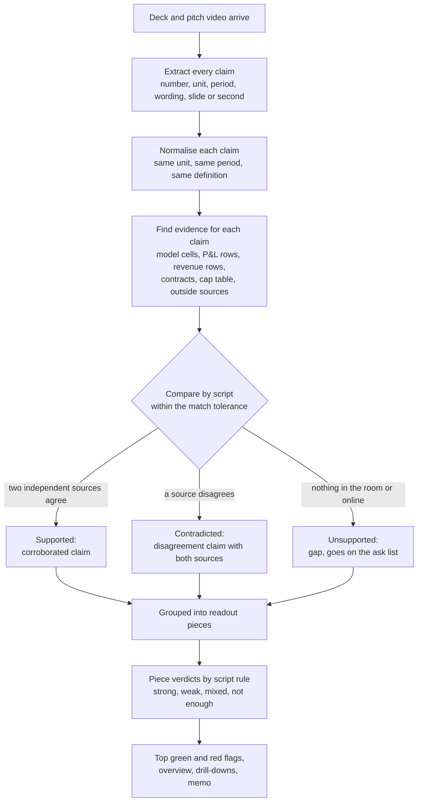

# The claims workflow

How Tricorder turns what a founder says into what the readout shows. The deck and the pitch video make the claims; every other document either supports a claim, contradicts it, or says nothing about it. Ken, 2:41 PM: "this is a feature workflow that needs to be documented. extract claims from the pitch deck and video, and see if the other docs support" ([writers' brief](../../features/20261022.01_hackathon_plan/00_brief_for_writers.md), 2:41 PM block).

It follows the reading order the data-room research found: read the deck first, because its claims are the list of things to check, then go to the cap table, the model, the P&L and metrics, the revenue rows and cohorts, then the contracts ([research_data_room.md](../../reports/20261022.02_research/research_data_room.md), 1.3).

## The steps

1. **Extract.** Every claim in the deck (each slide, including charts and the appendix) and in the video's transcript (each sentence with a number or a checkable fact) becomes a claim record: the wording as said, the number, its unit and period, the kind of claim (ARR, customers, growth, retention, margin, market size, team, round terms), and where it sits (slide and position, or the video second). A model reads the words; it quotes the span it read. On Saturday the deck's claims come from its appendix slide by regex, with `claims.json` as the fallback, and the video's from the transcript.
2. **Normalise.** A script puts each claim into the shared Claim schema ([FRAMEWORKS.md](../FRAMEWORKS.md)): one unit, one period, one definition. "About $3M ARR" said on video becomes ARR, about 3,000,000, as of the video's date, marked as spoken and rounded.
3. **Find evidence.** For each claim kind, the checklist and the document guides say where support should live: ARR in the revenue rows and the ARR build, customers in the revenue file, runway in the model and the bank, team in the bios and hiring plan, the round in the cap table. Outside sources count too (the associate's ten tabs). Missing documents expected at the company's stage are noted.
4. **Compare.** A script compares each claim with each piece of evidence within the match tolerance. The deck, the overview, the video and the website repeat each other, so together they count as one source.
5. **Label.** Each claim ends as supported (two independent sources agree), contradicted (a source disagrees; the claim, the evidence and both sources are shown), or unsupported (nothing found; a gap with an ask-list line).
6. **Feed the readout.** Claims group into pieces, pieces get verdicts by the script rule, and the top green and red flags, the overview, the drill-downs and the memo all draw on the labelled claims.

## Where it is built

- **Saturday:** the deck's appendix claims and the video's transcript claims, compared against the model and the revenue rows for the planted flags ([ROADMAP.md](../ROADMAP.md): `redflag-engine`, `pitch-video`, `readout`).
- **After Saturday:** every slide and every sentence, not just the appendix, and evidence from every document kind and the outside sources ([ROADMAP.md](../ROADMAP.md#claim-support), `claim-support`).
