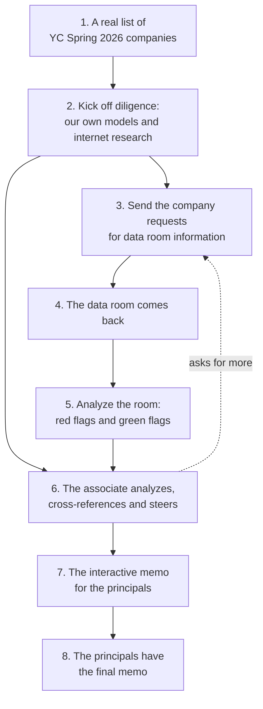

# The demo workflow

The framework for what Tricorder builds, in Ken's words (2026-10-24, 11:15 AM, on [his desk](../../KEN_DESK.md)): start with a real list of YC Spring 2026 companies and kick off diligence. Run our own models and do internet research. Send the company requests for data room information. Get that information from the data room and analyze it for red flags and green flags. The associate analyzes, cross-references, steers and makes sure it is good, and uses it to prepare the memo, which is an interactive deliverable for the principals. The principals have the final memo.

The real companies' data rooms are synthetic: we write them, and every page says so. Their outside-world research is real.

## Each step and what builds it

Status comes from [status.csv](../roadmap/status.csv), checked against the code.

| Step | Slices that build it | Status |
|---|---|---|
| 1. A real list of YC Spring 2026 companies | [company-setup](../roadmap/company-setup.md) (not started; the list of companies is saved), [yc-rooms](../roadmap/yc-rooms.md) | Waiting on Ken's pick. Candidates: [research_demo_companies.md](../../reports/20261022.02_research/research_demo_companies.md) |
| 2. Our own models and internet research | [outside-in](../roadmap/outside-in.md), [online-presence](../roadmap/online-presence.md), [founder-profiles](../roadmap/founder-profiles.md), [comps](../roadmap/comps.md), [market-signals](../roadmap/market-signals.md), [signals-readings](../roadmap/signals-readings.md), [frameworks-scan](../roadmap/frameworks-scan.md), [cached-data](../roadmap/cached-data.md) | Not started |
| 3. Requests for data room information | [room-requests](../roadmap/room-requests.md) (not started: the automatic check and the associate's editable list), [founder-requests](../roadmap/founder-requests.md) (done: the drafted message), [checklist-coverage](../roadmap/checklist-coverage.md) (partly built: what the room holds and lacks) | Partly built |
| 4. The data room comes back | [yc-rooms](../roadmap/yc-rooms.md) (the synthetic room per company), [room-templates](../roadmap/room-templates.md), [inbox-forward](../roadmap/inbox-forward.md) | Not started. A reply's file already lands in a working copy of a sample room (founder-requests) |
| 5. Red flags and green flags | [redflag-engine](../roadmap/redflag-engine.md) (partly built), [claim-support](../roadmap/claim-support.md) (partly built), [checklist-coverage](../roadmap/checklist-coverage.md) (partly built), [deck-vs-books](../roadmap/deck-vs-books.md), [accounting-mislabels](../roadmap/accounting-mislabels.md), [contract-terms](../roadmap/contract-terms.md) (done), [contract-terms-saturday](../roadmap/contract-terms-saturday.md), [pitch-video](../roadmap/pitch-video.md) (not started) | Mostly built |
| 6. The associate cross-references and steers | [readout](../roadmap/readout.md) (partly built), [readout-page](../roadmap/readout-page.md) (partly built), [steering](../roadmap/steering.md) (done), [readout-store](../roadmap/readout-store.md) (done) | Partly built |
| 7. The interactive memo for the principals | [memo-export](../roadmap/memo-export.md) (done), [reader-scenarios](../roadmap/reader-scenarios.md) (not started) | Built; each principal's own copy is not |
| 8. The principals have the final memo | [memo-export](../roadmap/memo-export.md): the page and the PDF | Done |
