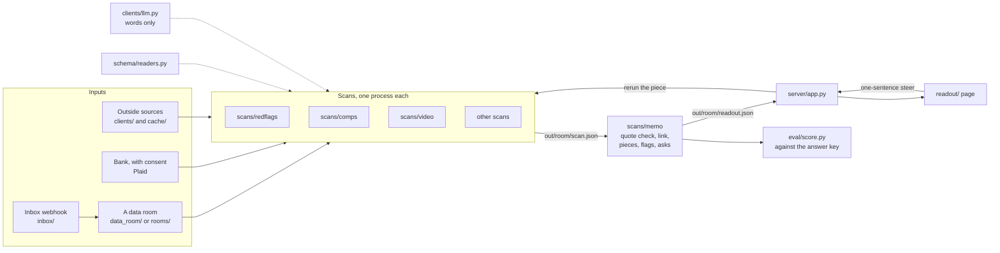

# The system

How a company's files become the page. Each box is a folder in the repo ([ARCHITECTURE.md](../ARCHITECTURE.md), "Folder layout").

Every number on the right side was computed by a script on the left. The model reads words and quotes them; the quote checker finds every quote again before it reaches the page.
