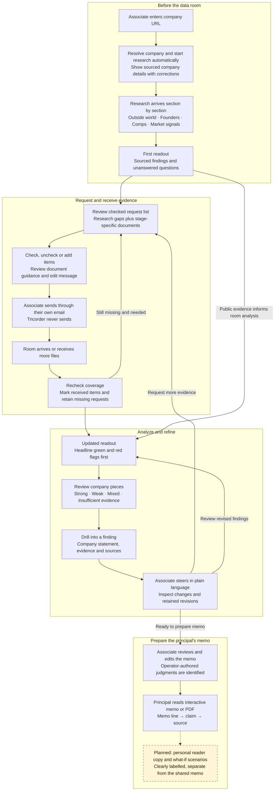

# Tricorder: product UX and user flow

Draft for discussion, 2026-10-24.

The core journey is **research → unanswered questions → targeted request → better understanding → an evidence-backed memo**.

This document brings together the prototype walkthrough, existing feature specifications, and proposed UX improvements. The diagram describes specified behavior. It is not a claim that every step is implemented or verified.

## User and outcome

The primary operator is an associate at a seed or Series A fund preparing diligence and a memo for principals. They begin with a company URL, establish what public evidence supports, identify what to ask the founder, and refine the readout as documents arrive.

The principal receives a memo whose claims can be traced to evidence. Personal reader copies and what-if scenarios are specified separately and were marked not started in the inspected roadmap.

## Specified user flow

The dashed branch identifies the reader-copy and scenario capability marked not started in the inspected roadmap. Solid connections describe the intended workflow, not implementation status.

## What the prototype demonstrates

| Step | Observed experience | UX opportunity |
| --- | --- | --- |
| Company entry | One URL field with example companies. | State the outcome clearly: a sourced company brief and questions to ask next. |
| First readout | Editable company details precede research grouped by source or topic. Research appears progressively, with source controls and explicit gaps. | Make the company easy to understand quickly, then show the most important findings and unknowns before detailed research. |
| Document request | Research gaps connect to document requests. All 19 items were selected in the inspected Ploy state. The associate can edit the list and message. | Preserve the explanation of why each item is needed. Explore whether the initial request should be more focused. |
| Room received | A synthetic-room notice and a handoff to a separate local application. | Show what arrived, which questions it answers, what remains missing, and what changed in the readout. |

The strongest existing interaction is the connection between an unanswered question and a concrete request for evidence. The design should make that relationship easy to follow throughout the journey.

## Proposed UX iterations

These are discussion proposals, not approved changes to the feature specifications.

### 1. Improve the first readout's hierarchy

Keep the sourced company identity at the top, as specified, but explore a compact presentation with an explicit edit action. Follow it with a short company summary, key findings, and important unknowns. Keep the detailed research available below.

Question to resolve: what should an associate understand after the first minute on this screen?

### 2. Preserve context while inspecting evidence

Explore a source panel that opens alongside the finding. It should make the source and supporting passage easy to inspect while preserving the reader's place in the readout.

Question to resolve: can the associate inspect a claim and return to the next question without losing context?

### 3. Make request scope intentional

Keep the mapping from research gaps to documents and the ability to check, uncheck, and add items. Consider a focused initial request, with standard diligence documents available to add.

This proposal changes the current first-steps brief, which includes gaps and stage-specific first-tier documents as checked items. The room-requests specification also checks missing items by default. The default needs an explicit product decision before implementation.

Question to resolve: is the first request intended to prepare the next founder conversation or collect the full first-tier diligence package?

### 4. Close the loop when documents arrive

Make the transition from requested evidence to updated understanding visible. Show received items, outstanding requests, and public claims that the room confirms or contradicts. These behaviors are already described in the expanded feature brief.

Question to resolve: can the associate tell what changed because of the new documents?

## Mobbin references

These references illustrate interaction patterns. They are not selected visual designs or evidence that the proposed UX has been validated with users.

- [ChatGPT research](https://mobbin.com/screens/73833b79-1dd5-4354-8fc4-a2e99c33a75e): a readable report with research activity and sources in a separate panel.
- [Gemini Notebook](https://mobbin.com/screens/859f9ce4-e9e8-40e4-9a3b-3e1a5997dcb8): distinct areas for source material and synthesized output.
- [Revolut Business document requests](https://mobbin.com/screens/874b18b7-720b-45eb-aeee-3ad124804e1f): grouped requests with an explicit status for each item.

## Requirements to preserve

- Company setup starts research automatically. The associate can correct sourced company details.
- Research arrives section by section. A failed or unavailable source leaves an explicit gap without blocking the other sections.
- Every claim carries its source. Missing evidence must remain visibly missing.
- The associate controls the request and sends it through their own email. Tricorder never sends it.
- Coverage runs again as the room grows. Received items drop off the outstanding request list.
- Steering preserves script-computed numbers and shows a visible revision history.
- The interactive memo supports the path from memo line to claim to source. The PDF carries source footnotes.
- Operator-authored judgments and reader scenarios are labelled distinctly from sourced findings.
- Real companies' demo data rooms are synthetic and must be labelled accordingly.

## Source specifications

These links point to the Tricorder specifications inspected for this draft.

- [First-steps UI brief, including the later flags, steering, and memo additions](../../features/20261024.02_first_steps_ui/01_brief.md)
- [Existing demo workflow](demo_workflow.md)
- [Room requests](../roadmap/room-requests.md)
- [Steering](../roadmap/steering.md)
- [Memo export](../roadmap/memo-export.md)
- [Reader copies and scenarios](../roadmap/reader-scenarios.md)
- [Readout verdicts and headline flags](../../features/20261023.07_readout_verdicts/00_spec.md)

## Evidence and limits

- The walkthrough covered the desktop prototype at `http://127.0.0.1:8099/index.html?company=https%3A%2F%2Fploy.ai#readout` and its entry, request, and room-received states.
- The linked application at `http://localhost:5173/` returned a 404 during that walkthrough. Downstream behavior in this diagram comes from the specifications, not that browser session.
- The first-steps brief explicitly describes simulated research arrival, saved facts, and placeholders in the prototype. It also contains later additions beyond the screens observed in the walkthrough.
- Mobile layout, keyboard access, screen-reader behavior, and measured contrast were not tested. The small source controls warrant an accessibility check.
- The Mermaid source has not been validated with a Mermaid renderer; none was available in the inspected local tooling.
- Captured prototype screenshots are omitted. Automatic approval review blocked embedding those images pending explicit permission to share them in the conversation.
- No product code or canonical Tricorder specifications were changed for this review.

## Recommended next iteration

Start with the **first readout → request list** transition. Settle the order of information on the readout and the intended scope of the initial founder request, then revise this flow before changing the interface.
